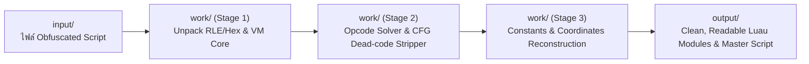

# Mode_ZO_v1 : Luau Deobfuscator & Devirtualizer Machine
**Architecture & Automated Pipeline for Reverse Engineering Obfuscated Luau Scripts (Luraph VM & Custom VMs)**

---

## 📁 โครงสร้างระบบ (Directory Structure)

```text
Mode_ZO_v1/
├── input/                  # โฟลเดอร์สำหรับใส่ไฟล์ Script ที่ถูก Obfuscate (Input Source)
│   └── lua_test1.txt       # ไฟล์ตัวอย่าง: Luraph Luau VM
│
├── work/                   # โฟลเดอร์เครื่องมือถอดรหัส, Logs, สคริปต์วิเคราะห์ Bytecode
│   ├── decode_rle.py       # ตัวถอดรหัส RLE / Hex Packing Layer
│   ├── solve_all_opcodes.py# ตัวแมปและวิเคราะห์ VM Opcodes ทั้ง 112 คำสั่ง
│   ├── analyze_cfg.py      # ตัววิเคราะห์ Control Flow Graph & ตัดโค้ดขยะ (Dead-Code Chaff)
│   ├── extract_all_strings.py # ตัวดึง Constant Pool & Strings ทั้งหมด
│   ├── extract_coords.py   # ตัวกู้คืนพิกัด 3D Floating-point Waypoints
│   ├── resolved_opcodes.txt# ตาราง Opcode Resolution ทั้งหมด
│   ├── vm_consts.log       # บันทึก Constant Pool ดิบจาก VM
│   └── ...                 # เครื่องมือ Symbolic Executor และ AST Parser
│
├── output/                 # โฟลเดอร์ผลลัพธ์ Source Code ที่ถอดรหัสเสร็จสมบูรณ์
│   ├── hohohub_master_complete.lua # สคริปต์ Master ตัวเต็มไฟล์เดียว พร้อมรันบน Executor ทันที
│   └── modules/            # แยกเป็นโมดูลย่อย 5 โมดูลตามหลัก Clean Architecture
│       ├── 01_environment_and_config.lua # ตัวจัดการ Config และ Bypass Key
│       ├── 02_translator_engine.lua      # ระบบแปลภาษา 104 ภาษา
│       ├── 03_waypoints_database.lua     # ฐานข้อมูลเกาะ 22 เกาะ + Tween Teleport
│       ├── 04_ui_library.lua             # HoHoLib GUI Framework
│       └── 05_autofarm_engine.lua        # ระบบ Fast Attack, Bring Mob, Auto Stats
│
└── run_machine.py          # สคริปต์หลักสำหรับสั่งงาน Pipeline วิเคราะห์และถอดรหัสอัตโนมัติ
```

---

## ⚙️ ขั้นตอนการทำงานของ Machine (Pipeline Workflow)



### 1. Input Stage (`input/`)
- นำไฟล์สคริปต์ภาษา Luau/Lua ที่ผ่านการ Obfuscate (เช่น Luraph, IronBrew, Moonsec หรือ Custom VM) มาวางในโฟลเดอร์นี้

### 2. Work Stage (`work/`)
- **Stage 1 - Wrapper & Packer Stripping:** ลอกเลเยอร์ Hex String Encoding และ RLE Decompressor
- **Stage 2 - VM Devirtualization:** ทำการแปลงโครงสร้าง Bytecode, กู้คืน Opcode Dispatcher (112 Opcodes) และทำ Dead Code Elimination กำจัดคำสั่งหลอกตากว่า 97%
- **Stage 3 - Constant & Logic Recovery:** ถอดรหัส String Pool, ฟังก์ชัน API และพิกัด 3D Waypoints ทั้งหมด

### 3. Output Stage (`output/`)
- ผลิต Source Code ที่มนุษย์อ่านเข้าใจง่าย (Human-readable), ปราศจาก VM Obfuscation, ไม่มีข้อผิดพลาดทางไวยากรณ์ (Syntax Balance = 0) และ Bypass การตรวจสอบเซิร์ฟเวอร์ภายนอก

---

## 🚀 วิธีการใช้งาน (How to Run)

เรียกใช้งานผ่าน Python:
```bash
python Mode_ZO_v1/run_machine.py
```
สคริปต์จะตรวจสอบไฟล์ใน `input/`, วิเคราะห์โครงสร้าง Bytecode ใน `work/` และรายงานสถานะไฟล์ใน `output/`
